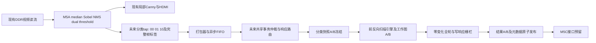

# M5B.0低频全局Canny架构

**架构与软件可行性分析完成；当前实施闸门NO-GO。** 软件算法和有限状态协议具有可复验结果；实际DDR新增安全区、共享仲裁实时性及真实场景低频输出尚无充分证据。推荐保留以下方案作为后续独立验证的设计输入，不将其写为M5B已实现。闸门逐项见 GO_NO_GO.md。

选择 **M5A NMS双阈值后的2bit分类快照 + 前向/反向完整八邻域传播 + 每方向工作图A/B交换 + 收敛后独立结果A/B**。BFS为独立软件黄金；Jacobi迭代作为简单备选和交叉检查。任何长链最终结果必须精确全局八连通，watchdog只改变是否成功发布，不改变全局定义。

图中“未来”组件均未实现；现有相机写、HDMI读共同使用单个DDR用户口，需通过有界延迟仲裁扩展接入，不能默认第二个空闲AXI口。计划不复制M5A工程，也不在本轮修改任何生产RTL。

|输入方案|每快照DDR载荷及额外需求|判断|
|---|---|---|
|冻结RAW后独立低频重算|RAW 921600B/帧；需给现有槽增加读租约，或先复制；新median/Sobel/direction/NMS整套及其时序/边界/阈值证明|当前4槽管理只跳过现读槽，不能保证长期冻结给第二reader；不优选|
|直接捕获分类|230400B/帧；打包器/FIFO/metadata、写DMA和仲裁；沿M5A定义|优选；仍需正式分类tap与实时QoS验证|
|捕获NMS幅值|原12bit幅值紧凑1382400B/帧，16bit容器1843200B/帧；support图另115200B或元数据定义边界；可离线多阈值试验|适合调试采集，初期不作为常规输入；out_nms已经饱和8bit，不得据其重造12bit分类|

实际tap位于 `rtl/m5a_streaming_canny/m5a_stream_top.v:28–35`：`nms_good`、`strong_edge`、`weak_edge`、`nms_packet`。强条件为support且nms!=0且nms>=H；弱为support且nms!=0且floor(H/2)<=nms<H（dual_threshold.v:5–7）。0阈值仍禁止nms=0变强。NMS沿方向负侧严格 `>`、正侧 `>=`（nms.v:26），不能另取OpenCV默认边界/阈值逻辑替代。

分类编码00背景、01弱、10强、11错误；strong和weak必须互斥。`nms_good=0`的完整图像位置仍输出00，所有1280×720坐标恰一次，不能只写有效NMS像素。默认median支持半径3、旁路2；这不是局部hysteresis再多一跳后的半径4。元数据记录support_radius、NMS规则版本、阈值和滤波模式。分类没有暴露为现成顶层端口，未来tap需正式修改新独立工程后验证。

frame_id定义为**M5A输入的DDR回放完整帧序号**，不是未证实的相机采集帧号；同一RAW被重复显示也有不同回放frame_id。未来若增加camera_capture_id，应另字段且证据不足时valid=0。source标签从M5A输入SOF事件开始锁存、随相同CE延迟到分类tap。阈值以已经进入nms_packet的值为准；控件在SOF同拍非阻塞更新的新值必须对应之后真实首像素，不能读取未生效pending值。metadata不得用最终RGB的6626CE延迟替代分类约4971CE拍路径；M5B.1须用带标签仿真逐帧边界复核准确采样时刻。

初期请求策略为单job在途，无工作覆盖：IDLE请求仅ARM下一个完整分类SOF，busy时请求拒绝并计数，不抢占实时流，不默默换帧。允许保留上一有效结果供将来读取，但其age继续增长；无真实consumer本轮只保留接口。A/B快照为明晰轮换与以后流水预留，初期不并发捕获第二任务以简化所有权证明。

推荐引擎每像素采用 `strong OR (weak AND any_8_neighbors)`；从上一工作图取尚未扫描的邻居，从行缓存取本扫描已更新邻居。先正序再逆序，正/反各写另一个工作图后交换；新值只增不减。反扫使用递增AXI INCR读取整行，再倒序消费；输出按行缓存重新正序打包，不发反向AXI突发。分类只读冻结，同job配置不可变化。每扫描DDR流量为分类230400R+工作115200R+工作115200W=460800B。

典型合成图为4～8扫描（含最后零变化双向轮），每job约2.65～4.49MB；横蛇362扫描，竖蛇642扫描，分别约167.62/296.64MB。这些是软件精确计数，不是现场典型分布或FPGA性能实测。1～2fps仅为待验证目标，最坏图案不会保证每秒有效结果。

watchdog建议初始64双向轮或1秒DDR域计时，另设由服务预算推导的事务进展watchdog。触发后设置timeout、禁止ready、保留旧有效结果/无结果；未决事务先drain或隔离，缓冲不能立即改属其他帧。计数只能在完整两扫及写响应、流水changed归约全部完成后判断converged。

资源为估算：追加6k～16k XLR、33～64 RAM10、0 DSP目标，不是综合结论。最高估算合计25425XLR/169RAM/0DSP，可保留>20%总资源；实际FIFO端口/布线/hold尚须验证。整帧工作状态必须放DDR。见 RESOURCE_FEASIBILITY.md。

复算软件：`run_models.py`、`check_addresses.py`、`calculate_bandwidth.py`、`protocol_model.py`，均仅Python标准库。结果文件、证据索引及主会话独立复核各自保留；不以软件协议模型代替CDC/RTL仿真、IP时序模型或上板验证。
